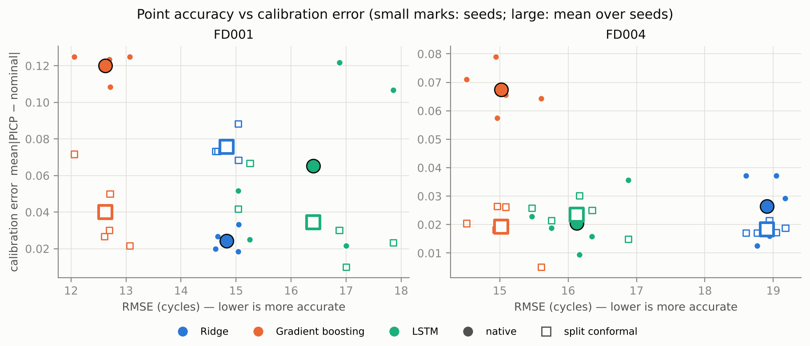

# Accurate but Overconfident?

**Point accuracy and interval calibration of remaining-useful-life (RUL) models on NASA C-MAPSS**

MSc thesis code, Sahar Zare, GISMA University of Applied Sciences (supervisor: Christoph Metzner), 2026.

> **Status:** draft. All experiments are finished; the thesis text is under revision.

---

## Research question

**Do RUL models with lower point-prediction error also give better prediction intervals?**

The question is studied in two settings:

1. **Native intervals:** the uncertainty each model produces by itself.
2. **Conformal intervals:** all models wrapped in one shared split-conformal method, calibrated on held-out engines.

## Main results

Seed-averaged over five runs; 95% engine-bootstrap intervals are in `main/results/tables/`.

| Model | RMSE FD001 | RMSE FD004 | 90% coverage, native (FD001 / FD004) | 90% coverage, conformal (FD001 / FD004) | 90% conformal width FD004 (cycles) |
|---|---|---|---|---|---|
| Ridge regression | 14.83 | 18.91 | 0.93 / 0.91 | 0.95 / 0.92 | 54.0 |
| Gradient boosting | **12.63** | **15.02** | **0.85 / 0.83** | 0.94 / 0.92 | **45.4** |
| LSTM (β-NLL) | 16.44 | 16.13 | 0.83 / 0.89 | 0.91 / 0.93 | 48.4 |

- **Native intervals:** the most accurate model (gradient boosting) is the worst calibrated, and it misses one-sidedly: it overestimates remaining life near failure.
- **After split conformal:** all models are close to nominal coverage, and on FD004 interval width follows accuracy for every model pair.
- **Life stage:** constant-width conformal intervals over-cover near failure and under-cover in mid-life.



## Method in brief

| | |
|---|---|
| **Data** | NASA C-MAPSS FD001 (1 operating condition, 1 fault mode) and FD004 (6 conditions, 2 fault modes); 14 sensors, 30-cycle windows, RUL capped at 125 |
| **Splits** | By engine: fitting / validation / 30% calibration / official test set; 5 seeds |
| **Models** | Ridge (Gaussian interval, constant width), LightGBM point model with quantile models (12 levels), 2-layer LSTM with mean and variance heads (β-NLL) |
| **Intervals** | Native, and engine-weighted split conformal with finite-sample correction |
| **Metrics** | PICP, MPIW, interval score, calibration error over 6 levels; RMSE, MAE |
| **Statistics** | Paired engine bootstrap (2,000 resamples); hypotheses pre-registered |

## Repository structure

```
main/                     Main study (the thesis)
  PREREGISTRATION.md      Hypotheses H1–H4 and analysis plan, frozen before the main runs
  PREREGISTRATION.sha256  Checksum of the pre-registration
  DEVIATIONS.md           Every change after pre-registration (D1–D8), with reason and effect
  run_main.py             Trains the three models for one subset and seed
  analyze_main.py         Metrics, tables and figures
  inference.py            Hypothesis tests (paired engine bootstrap)
  extra_checks.py         Supporting analyses
  run_recal.py, analyze_recal.py   Exploratory D7: isotonic recalibration, variance scaling
  run_uq.py, analyze_uq.py         Exploratory D8: deep ensemble, MC dropout, CQR, normalised conformal
  results/tables/         All result tables (CSV)
  results/figures/        All figures (PNG, PDF)
src/                      Shared modules: data loading and windows, features, conformal methods; test_sanity.py
RUL_thesis_colab.ipynb    Runs the whole study in Google Colab
SHA256SUMS.txt            Checksums of the C-MAPSS files used
```

## Reproduce

Requirements: Python 3.12+, CPU only. Install with `pip install -r requirements.txt`.

1. Download the C-MAPSS text files from the NASA Prognostics Data Repository and put them in `data_raw/`. Check them against `SHA256SUMS.txt`.
2. Run the main study (about 10 minutes on 2 CPU cores):
   ```bash
   cd main
   for fd in FD001 FD004; do for s in 0 1 2 3 4; do python run_main.py $fd $s; done; done
   python analyze_main.py
   python inference.py
   python extra_checks.py
   ```
3. Optional, exploratory analyses:
   ```bash
   for fd in FD001 FD004; do for s in 0 1 2 3 4; do python run_recal.py $fd $s; python run_uq.py $fd $s; done; done
   python analyze_recal.py
   python analyze_uq.py
   ```

A Colab notebook that runs everything in one go: `RUL_thesis_colab.ipynb` (open it in Google Colab).

Re-runs with other library versions can differ in the third decimal place; the conclusions do not change.

## Transparency

- Hypotheses were pre-registered and frozen by checksum before the main experiments.
- An earlier pilot study had seen the FD001 and FD004 test sets, so FD001 results are reported as exploratory and FD004 results as pre-specified but not blind.
- All deviations from the plan are listed in `main/DEVIATIONS.md`.

## Data

NASA C-MAPSS turbofan degradation data (Saxena et al., 2008). The data are not included in this repository.
